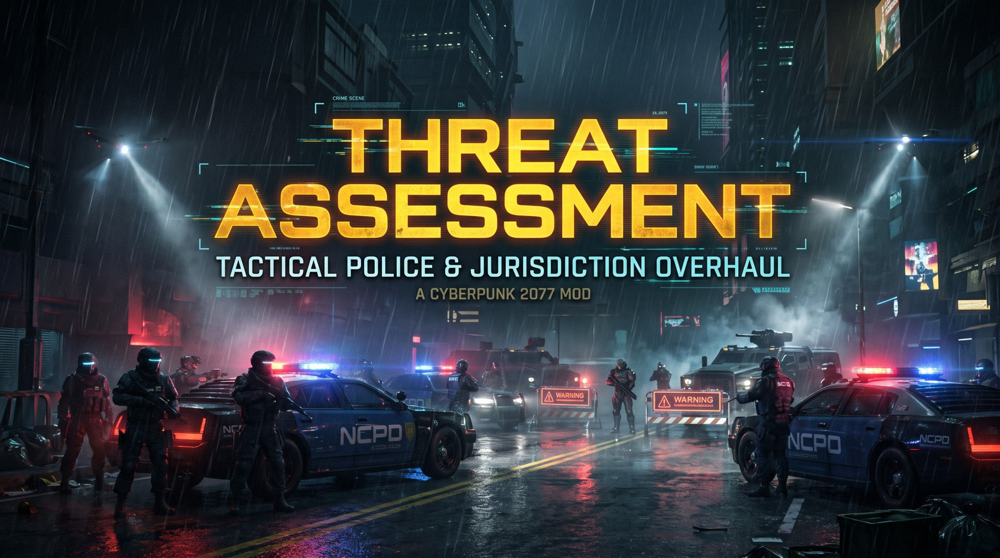
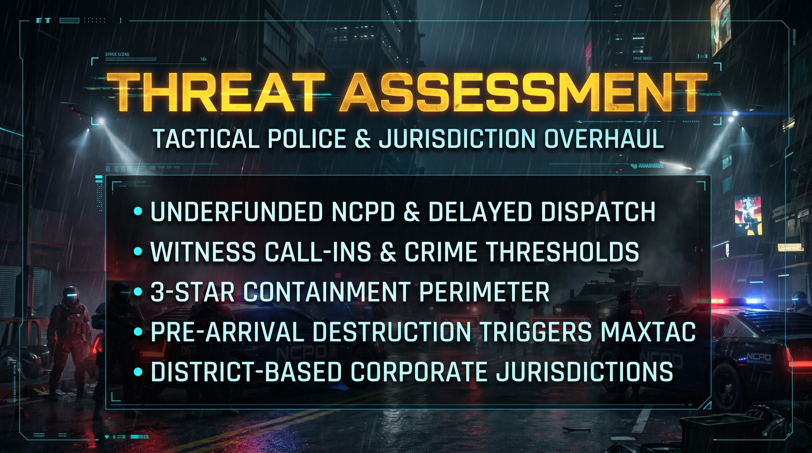

# Threat Assessment – Tactical Police & Jurisdiction Overhaul

A Cyberpunk 2077 (2.5, Phantom Liberty supported) mod that makes the NCPD act like the underfunded,
understaffed department it is in the lore. Petty crime gets ignored. Real trouble gets a fast,
organised response, and only major crimes bring the heavy hitters.

**Version 0.5.1 beta.** Every planned core feature is in. See [TESTING.md](TESTING.md) for what to
try and [CHANGELOG.md](CHANGELOG.md) for what changed.

## What it does now

- **Petty crime filter.** With no stars, a civilian hit in a crossfire or run over at the roadside is
  not a police matter. Heat starts only after several civilian deaths in a short time (default 3 in
  30 seconds), or on any attack on police. Witness calls about crimes the filter ignored don't start
  a chase.
- **Witnesses have to finish the call.** With no stars, a civilian calling NCPD takes time (default
  10 seconds). Kill or knock out the caller first and nobody comes. Whether a witness calls at all
  depends on the district: most do in City Center and Westbrook, few do in Santo Domingo, Pacifica,
  the Badlands and Dogtown. An on-screen warning tells you when a call starts, goes through or is
  cut off.
- **Fast ramp, then a plateau.** Once the police care, heat climbs to 3 stars quickly and then stops.
  Ordinary crimes add nothing from 3 stars on.
- **A thin response, then a big one.** 1 and 2 stars bring a few officers, and slowly. At 3 stars the
  department commits: twice the base game's officers and cars, all sent to the perimeter.
- **Rich districts first.** City Center and Westbrook get more officers, sooner. Santo Domingo and
  the Badlands get fewer, later.
- **Police go to the crime scene.** At 1 and 2 stars, cars drive to where the crime happened and the
  officers search from there, instead of driving straight at you.
- **Fewer patrols.** Half as many police cars in traffic and officers on foot patrol by default. Cops
  placed at crime scenes and checkpoints by the game stay.
- **Heat that lasts.** Once the police lose you they keep searching for at least 5 in-game minutes
  before they give up.
- **Major crimes for 4 and 5 stars.** Only destroyed police vehicles, explosions on police, and a high
  police body count push the heat past 3. MaxTac comes only for sustained escalation.
- **3-star containment perimeter.** Officers form a ring around V (default 30 m), take cover near it
  and fight from there instead of rushing in. Arriving police cars park on the ring and the officers
  get out there, so the cars become part of the perimeter. Beat cops and officers in ordinary body
  armor never go inside the ring. The ring follows V at a jog, and heat is frozen while V is inside it.
- **Breaking out.** Outrun the ring and it breaks, heat unfreezes, and low-ranking officers may flee.
  The more police V has killed, the more likely.
- **Only the heavy hitters go in.** At 5 stars MaxTac and heavily armored units (Elite rank, heavy
  weapons) move inside the ring while regular officers keep holding it.
- **Corporate jurisdictions.** In Corpo Plaza, Downtown, Arasaka Waterfront and North Oak, the
  corporation that owns the turf takes over: NCPD handles 1 and 2 stars, pulls out completely at 3
  and 4 stars and leaves it to corporate security, then comes back at 5 stars alongside the
  corporation (one for one) and MaxTac. Arasaka, Militech or Kang Tao, or a random one on shared
  ground. Only one corporation answers per chase. Heavier units at 4 stars (Militech brings
  drones), elites and a mech at 5. They hold the perimeter like the police, and their elites go in
  with MaxTac. Every district can be set to any corporation or to NCPD only. Attack a corporation's
  guards out in the city and it sends a squad after you even with no stars.
- **Dogtown and Pacifica.** NCPD isn't allowed in Dogtown: Barghest answers instead, from 1 star,
  with its elites and exo suits at 5 stars, when MaxTac also flies in. NCPD doesn't come to Pacifica
  at all: crimes there add no heat, witnesses don't call, police chasing you turn back at the
  border, and your heat clears after a short time there. Dogtown is its own jurisdiction: cross its border either way and your heat is gone. NCPD
  heat never follows you in, and Barghest heat never follows you out.
- **Officer voice lines.** Officers and corporate soldiers call out the perimeter, breakouts,
  fleeing, MaxTac arriving and giving up, in their own voices, using the game's own lines.
- **Quest safe.** The mod does nothing while a quest is controlling the police, never gives orders to
  or counts quest characters, and never spawns squads inside a corporation's own restricted areas.
  A pause key (default F7) switches everything off and back on in a moment.
- **Every feature has a setting.** All settings apply live.

## Planned after 0.5

Optional toggles (bribes, panic investigation, distance-based escape, no heat for unseen quickhacks,
sticky heat) and deeper integration with They Will Remember and Night City Alive (self-defense rule,
gang reputation and witnesses, disguises).

## Requirements

- [redscript](https://www.nexusmods.com/cyberpunk2077/mods/1511)
- [TweakXL](https://www.nexusmods.com/cyberpunk2077/mods/4197) (response size per star)
- [Codeware](https://www.nexusmods.com/cyberpunk2077/mods/7780) (corporate squads)
- Optional, for the settings menu: [Mod Settings](https://www.nexusmods.com/cyberpunk2077/mods/4885)
  or [Mod Configuration Menu](https://www.nexusmods.com/cyberpunk2077/mods/31640). Without either,
  the defaults apply.

No REDmod, no archives, no tweak files: the few game values it changes are set one at a time while
the game runs.

## Install

Install the release zip with your mod manager, or copy its `r6` folder into your Cyberpunk 2077
game folder. Some settings (patrol numbers) apply after restarting the game; the settings menu says
which.

## Compatibility

Every game function the mod touches is wrapped, never replaced. See
[COMPATIBILITY.md](COMPATIBILITY.md) for the full list and the mods it was checked against.
Night City Alive users: skip its optional "Sensitive Prevention" file, which works against the
petty crime filter.

## Reporting a bug

Turn on **Debug log** in the settings, reproduce the problem, and open an issue with the
`[ThreatAssessment]` lines from `bin\x64\plugins\cyber_engine_tweaks\gamelog.log`, your game
version, your mod list and your settings.

## Credits and inspiration

All code in this repository was written fresh. These mods inspired the ideas, and no code was taken
from them:

- NCPD and MaxTac Spawn Tweak – no reinforcements for minor crimes, response by district wealth
- Someone Call The Police – accident filter, witnesses who must finish a call
- Stealth Prevention – police respond to the crime scene, unseen quickhacks
- Law Enforcement Overhaul – fewer cops and longer delays at low stars
- NCPD Prevention Police Enhancement – crime score rebalance, distance-based escape
- Eyes on V – civilian witnesses don't trigger stars automatically
- NCPD Bribe (Ghxst Protocol) – bribes
- NCPD Duty Expansion – sticky heat
- Vehicle Theft and Stock Market Economy Overhaul – fewer lone foot patrols
- No immediately police reinforcements – longer search times
- No Police Dispatch – dispatch radio logic
- Lore-Accurate Adam Smasher – spawning corporate squads

The code was written with AI assistance (Claude).

## License

GPL-3.0. See [LICENSE](LICENSE). You can share, change and redistribute this mod, but anything built
from it must stay open source under the same license.
